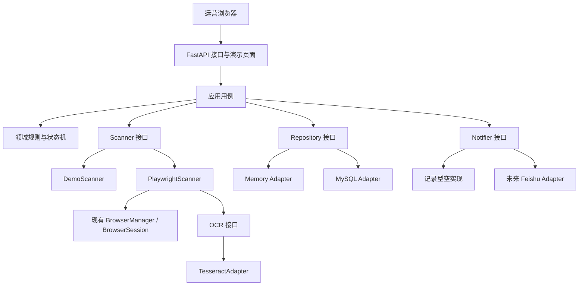

# 商品加购入口库存风险监控 Agent

## 1. 文档定位

本文档是基于以下材料形成的技术选型与架构设计初稿：

- `prd_mvp.md`
- `TDD.md`
- `docs/DESIGN-CODE-ARCHITECTURE-PLAN.md`
- 现有 Python 爬虫、Playwright 浏览器会话、平台 YAML 配置和 FastAPI MVP

设计目标是让当前静态演示可以平滑演进为真实商品页面扫描，同时保持模块化单体、简单部署、可测试和可替换。

## 2. 设计范围

### 2.1 当前 MVP

- 使用 FastAPI 提供本地页面和 HTTP 接口。
- 使用内存 fixture 展示德国和意大利共 20 个商品。
- 用确定性结果模拟健康、库存风险和技术故障。
- 演示库存风险告警、重复告警去重和修复复查。
- 不访问真实商品页面，不执行真实 OCR，不接入飞书。

### 2.2 MVP 之后的真实扫描

- 使用 Playwright 打开 Amazon、Shopify 等真实商品页面。
- 固定视口、等待条件和 ROI 区域后截图。
- 使用本地 OCR 识别英文、德文和意大利文加购词汇。
- 每小时调度扫描任务。
- 将扫描结果和告警持久化到 MySQL。
- 保留飞书通知的适配器接口，但暂不接入实际发送。

### 2.3 明确不做

- 不拆分微服务。
- 不引入分布式队列、分片、多地域执行或复杂事件总线。
- 不自动修改平台库存。
- 不以真实点击加入购物车作为第一版判定条件。
- 不把技术故障转换为库存风险，也不以技术故障自动关闭库存告警。

## 3. 文档冲突与处理

| 冲突 | 当前处理 | 说明 |
|---|---|---|
| `prd_mvp.md` 要求 MVP 不接数据库，架构输入确定 MySQL 为系统事实来源 | MVP 继续使用内存，真实扫描阶段接入 MySQL | 不修改 MVP 范围，同时提前固定持久化边界 |
| `prd_mvp.md` 暂不实现每小时后台调度，业务目标要求每小时扫描 | MVP 只提供手动扫描，真实扫描阶段加入调度器 | 调度器不进入当前演示闭环 |
| `TDD.md` 要求 `not_scanned`、`scanning` 和演示结果切换，现有 `app/mvp` 代码仍以 `demo_status` 为主 | 将状态机作为目标设计，补充实现任务 | 当前代码不能视为这些状态已经完整实现 |
| 第一版不接飞书，但完整业务需要通知 | 先定义 `Notifier` 接口，使用空实现或记录实现 | 后续接入飞书不改变领域用例 |

这些是设计约束和实现顺序的差异，不改变已经确认的 MVP 业务目标。

## 4. 技术选型

### 4.1 选型结论

| 领域 | 选择 | 使用阶段 | 选择原因 |
|---|---|---|---|
| 语言 | Python 3.12（uv管理） | MVP 和正式版本 | 现有项目已经使用 Python，Playwright 和 OCR 生态匹配 |
| HTTP 服务 | FastAPI + Uvicorn | MVP 和正式版本 | 已在依赖中，适合 API、健康检查和轻量本地服务 |
| 数据校验 | Pydantic | MVP 和正式版本 | 现有项目已使用，适合请求、领域结果和配置校验 |
| 浏览器 | Playwright | 真实扫描阶段 | 现有爬虫已经封装浏览器管理、会话和截图能力 |
| OCR | 本地 OCR 适配器，首选 Tesseract + `eng/deu/ita` 语言包 | 真实扫描阶段 | ROI 小、词汇有限、扫描量低，优先选择简单可替换的本地实现 |
| 数据库 | MySQL 8.x | 真实扫描阶段 | 用户已确定，适合商品、扫描、告警和历史状态记录 |
| ORM/迁移 | SQLAlchemy 2.x + Alembic | 接入 MySQL 时 | 将 SQL 和迁移细节隔离在基础设施适配器，便于测试和演进 |
| 图片存储 | MVP 使用本地路径，正式环境保留对象存储适配器 | 分阶段 | 当前只需演示，异常图片增多后可切换对象存储 |
| 调度 | 单进程定时入口或系统计划任务 | 真实扫描初期 | 每小时扫描 20 个商品，不需要队列；规模增加再评估任务队列 |
| 通知 | `Notifier` 接口，第一版空实现/记录实现，后续飞书适配器 | 分阶段 | 不让通知平台渗透到库存告警规则 |
| 前端 | 当前 FastAPI 返回的原生 HTML/JavaScript | MVP | 无需引入前端构建链，足够演示业务闭环 |

### 4.2 OCR 选择边界

OCR 只能通过接口进入应用层。领域层只接收：

```text
OcrResult(text, confidence, boxes, engine, error)
```

首选 Tesseract 的原因是 ROI 面积小、目标词汇有限、扫描量低，且可以在本地运行。若真实页面基准测试显示德文或意大利文识别率不足，再替换为 PaddleOCR 等实现。替换 OCR 引擎不应改动商品状态、告警和复查用例。

## 5. 总体架构

采用模块化单体。一个 Python 进程可以同时提供 HTTP 接口、手动扫描和后续调度入口，模块通过明确接口协作，暂不拆成独立部署单元。



## 6. 分层和依赖规则

### 6.1 领域层

领域层只包含业务概念和不依赖框架的规则：

- `Product`
- `Scan`
- `Alert`
- 商品扫描状态机
- 告警状态机
- 加购词匹配结果
- 技术故障与库存风险的边界

领域层不能导入 FastAPI、Playwright、SQLAlchemy、Tesseract、MySQL 或飞书 SDK。

### 6.2 应用层

应用层编排用例和事务边界：

- `ScanProduct`
- `SetDemoScanOutcome`
- `VerifyAlert`
- `ListProducts`
- `ListScans`
- `ListAlerts`
- `RunScheduledScan`

应用层依赖领域对象和端口接口，不依赖具体适配器。

### 6.3 接口适配层

接口适配层负责把 HTTP 请求、页面交互和外部结果转换为应用层输入：

- FastAPI 路由
- HTML/JavaScript 演示页面
- 请求和响应模型
- 错误到 HTTP 状态码的映射

FastAPI 的请求模型不能直接成为领域对象。

### 6.4 基础设施适配层

基础设施适配层实现具体外部能力：

- `DemoScanner`
- `PlaywrightScanner`
- `TesseractOcrAdapter`
- `MemoryProductRepository`
- `MySqlScanRepository`
- `LocalArtifactStore`
- 后续 `ObjectStorageArtifactStore`
- `NullNotifier`
- 后续 `FeishuNotifier`

## 7. 模块边界

建议目录结构：

```text
app/
  monitoring/
    domain/
      models.py
      states.py
      policies.py
    application/
      scan_product.py
      verify_alert.py
      list_status.py
      ports.py
    adapters/
      demo_scanner.py
      playwright_scanner.py
      ocr_tesseract.py
      repositories_memory.py
      repositories_mysql.py
      artifact_store_local.py
      notifier_null.py
      notifier_feishu.py
    api/
      routes.py
      schemas.py
  mvp/
    api.py
    store.py
    models.py
    templates/
```

当前 `app/mvp` 可以继续作为演示入口。真实扫描接入时，优先将 `DemoStore` 的行为迁移到 `monitoring` 的应用用例和适配器，不直接把 Playwright 调用塞进 FastAPI 路由。

## 8. 领域模型

### 8.1 商品

`Product` 表示一个国家市场中的商品监控目标。相同 SKU 在德国和意大利可以是两个不同的监控目标。

关键字段：

- `id`
- `country`
- `platform`
- `sku`
- `url`
- `page_type`
- `roi_profile_id`
- `enabled`

### 8.2 扫描

`Scan` 表示一次商品检查。扫描必须有明确的开始、结束和结果。

商品扫描状态：

```text
not_scanned → scanning → healthy
                         ├→ inventory_risk
                         └→ technical_failure
```

不允许：

- 从 `technical_failure` 直接推导 `inventory_risk`。
- 在同一商品仍为 `scanning` 时创建第二个并发扫描。
- 用技术故障结束库存风险告警。

### 8.3 告警

`Alert` 表示需要运营处理的业务事件，不等同于一次扫描。

告警类型：

- `PRODUCT_ADD_TO_CART_MISSING`
- `MONITORING_TECHNICAL_FAILURE`

库存风险告警状态：

```text
open → acknowledged → pending_verification → resolved
                                      └──────→ reopened
```

同一个商品、同一种库存风险在未关闭前只允许存在一个活动告警。重复扫描更新失败次数和最近证据，不创建重复告警。

### 8.4 扫描结果

`ScanResult` 保存 OCR 文本、匹配词、置信度、错误原因、截图引用和环境摘要。它是可追溯证据，不负责决定告警生命周期。

## 9. 关键接口边界

### 9.1 Scanner

```python
class Scanner(Protocol):
    async def scan(self, target: ScanTarget) -> ScanObservation:
        ...
```

`DemoScanner` 返回确定性演示结果，`PlaywrightScanner` 负责真实页面访问、等待、截图和 ROI 产物生成。应用层只依赖 `ScanObservation`。

### 9.2 OCR

```python
class OcrEngine(Protocol):
    async def recognize(self, image: ImageRegion) -> OcrResult:
        ...
```

OCR 适配器只负责识别。词库归一化和是否匹配加入购物车词汇属于应用/领域规则，不能写死在 Tesseract 适配器中。

### 9.3 Repository

```python
class ProductRepository(Protocol):
    async def get(self, product_id: str) -> Product | None:
    async def list_enabled(self) -> list[Product]:

class ScanRepository(Protocol):
    async def add(self, scan: Scan) -> None:
    async def latest_for(self, product_id: str) -> Scan | None:

class AlertRepository(Protocol):
    async def find_open_inventory_alert(self, product_id: str) -> Alert | None:
    async def save(self, alert: Alert) -> None:
```

MySQL 只实现这些接口，不向领域和应用层暴露 SQLAlchemy Session。

### 9.4 Notifier

```python
class Notifier(Protocol):
    async def notify(self, event: AlertEvent) -> None:
```

第一版使用记录型空实现。飞书适配器未来负责消息格式、重试和超时，不能改变告警状态机。

## 10. 主要业务流程

### 10.1 手动扫描

```text
HTTP 请求
  → ScanProduct 用例
  → 检查商品是否 enabled
  → 检查是否已有 scanning 任务
  → 创建 scanning 记录
  → 调用 Scanner
  → 保存 ScanResult
  → 根据观察结果运行领域状态规则
  → 创建或更新 Alert
  → 返回商品状态、扫描结果和告警摘要
```

### 10.2 修复复查

```text
运营标记已处理
  → Alert = pending_verification
  → 强制执行一次 Scanner
  → healthy：Alert = resolved
  → inventory_risk：Alert = reopened
  → technical_failure：Alert 保持 pending_verification，不关闭
```

### 10.3 每小时扫描

第一阶段使用单进程调度入口读取启用商品并顺序或有限并发调用 `ScanProduct`。调度器不包含业务判断，只负责触发用例和记录执行结果。规模增加前不引入消息队列。

## 11. MySQL 数据设计

MySQL 是真实扫描阶段的系统事实来源。MVP 继续使用内存适配器，数据模型保持一致。

### 11.1 `products`

- `id` 主键
- `country`
- `platform`
- `sku`
- `name`
- `url`
- `page_type`
- `roi_profile_id`
- `enabled`
- `created_at`
- `updated_at`

唯一约束建议为 `country + platform + sku`。

### 11.2 `scan_runs`

- `id` 主键
- `product_id` 外键
- `status`
- `started_at`
- `finished_at`
- `ocr_text`
- `matched_phrase`
- `ocr_confidence`
- `error_code`
- `error_message`
- `full_artifact_id`
- `roi_artifact_id`

索引：`product_id + started_at`、`status + started_at`。

### 11.3 `alerts`

- `id` 主键
- `type`
- `status`
- `product_id` 外键
- `first_seen_at`
- `last_seen_at`
- `failure_count`
- `operator_note`
- `resolved_at`

需要通过应用层或数据库约束保证同一商品同一活动库存告警唯一。

### 11.4 `alert_transitions`

记录状态变化、操作者、原因和关联扫描 ID，便于复盘修复过程。

### 11.5 `artifacts`

记录完整截图和 ROI 截图的路径、类型、创建时间和删除时间。图片本身不放在 MySQL BLOB 中，第一阶段可以保存本地路径，后续替换对象存储适配器。

### 11.6 `roi_profiles` 和 `phrase_sets`

分别保存平台/页面类型的 ROI 配置和国家/平台/页面类型的加购词库。它们是配置数据，不应写死在告警规则中。

## 12. API 设计

MVP 现有接口继续保留：

| 方法 | 路径 | 说明 |
|---|---|---|
| GET | `/api/health` | 服务健康状态 |
| GET | `/api/products` | 商品及当前状态 |
| GET | `/api/scans` | 最近扫描结果 |
| GET | `/api/alerts` | 告警列表 |
| POST | `/api/products/{product_id}/scan` | 执行一次扫描 |
| POST | `/api/alerts/{alert_id}/verify` | 标记处理并复查 |

演示结果切换建议使用独立接口：

```text
POST /api/products/{product_id}/demo-result
{ "result": "healthy" | "inventory_risk" | "technical_failure" }
```

真实扫描接入后该接口只保留在 demo 配置下，不进入生产路由。

## 13. 可靠性设计

### 13.1 外部依赖

| 依赖 | 当前策略 | 真实扫描阶段要求 |
|---|---|---|
| 商品页面 | MVP 不访问 | Playwright 导航和读取超时 |
| Playwright | MVP 不调用 | 每个页面设置连接/读取/等待上限 |
| OCR | MVP 模拟 | 单次识别超时，错误映射为技术故障 |
| MySQL | MVP 不连接 | 连接池、事务边界和健康检查 |
| 飞书 | MVP 不发送 | 超时、有限重试、失败记录，不阻塞扫描用例 |

### 13.2 故障规则

- 技术故障不产生库存风险告警。
- 技术故障不关闭已有库存风险告警。
- 重试只用于技术故障，不用于有效的“未识别加购文字”。
- 扫描任务必须有超时和最终状态，不能永久停留在 `scanning`。
- 列表接口进入真实数据阶段必须分页或限制数量。

## 14. 安全与数据边界

- 不保存完整 Cookie 值，只保存允许的脱敏摘要。
- 不把商品页面截图发送给云端 OCR。
- 不在日志、告警或数据库中写入 API Key、登录状态或密码。
- 商品 URL、截图路径和 OCR 文本属于运营数据，需要限制访问范围。
- 未来飞书通知只发送必要的告警摘要和证据链接，不发送 Cookie 或完整页面凭据。

## 15. 测试架构

测试分为三层：

1. 领域单元测试：验证状态机、告警去重和技术故障边界，不依赖 FastAPI、MySQL 或 Playwright。
2. 应用/API 合约测试：验证用例与 HTTP 接口，使用内存适配器。
3. 真实扫描适配器测试：使用假的页面和假的 OCR，验证 Playwright/OCR 适配器的失败映射；真实站点只做手动验收。

`TDD.md` 中的 `not_scanned`、`scanning`、演示结果切换、技术故障隔离和复查恢复测试是实现顺序的依据。

## 16. 交付顺序

### 阶段 A：MVP 业务状态

- 完成商品、扫描、告警和复查领域模型。
- 补齐 `not_scanned` 和 `scanning`。
- 增加演示结果切换。
- 保持内存适配器和本地 FastAPI 页面。

### 阶段 B：MySQL 持久化

- 创建 Alembic 初始迁移。
- 实现 Product、Scan、Alert、Transition 和 Artifact 仓储。
- 保持领域测试不依赖 MySQL。

### 阶段 C：真实扫描

- 实现 PlaywrightScanner。
- 实现 ROI 裁剪和本地 OCR 适配器。
- 接入国家/平台/页面类型词库。
- 增加技术失败重试和扫描超时。

### 阶段 D：调度与运营能力

- 增加每小时调度入口。
- 增加健康截图清理和异常证据保留策略。
- 增加飞书 Notifier。
- 根据真实商品数量重新评估并发和队列。

## 17. 决策日志

| 决策 | 选择 | 原因 | 拒绝的替代方案 |
|---|---|---|---|
| 部署形态 | 模块化单体 | 项目规模小、团队单一、每小时 20 个商品 | 微服务、分布式任务系统 |
| HTTP 框架 | FastAPI | 现有依赖和代码基础已经采用 | 新增 Node.js/NestJS 服务 |
| 浏览器自动化 | 复用 Playwright | 现有项目已有会话、平台和截图能力 | 重新引入 Selenium 或重写浏览器层 |
| OCR | 本地 OCR 适配器，首选 Tesseract | ROI 小、词汇有限、数据不外发 | 第一版直接绑定云端 OCR |
| 数据库 | MySQL | 已由用户确定为系统事实来源 | MongoDB、PostgreSQL、多数据库并存 |
| 调度 | 单进程/系统计划任务起步 | 当前负载低，先验证闭环 | 立即引入 Celery、Kafka 或分布式队列 |
| 图片存储 | 本地路径起步，对象存储可替换 | MVP 存储量小，接口可替换 | 直接把图片写入 MySQL BLOB |
| 通知 | Notifier 接口，飞书后接 | MVP 不做飞书，避免业务规则绑定供应商 | 在用例中直接调用飞书 SDK |

## 18. 未决问题

- 正式版本商品数量和峰值扫描时长尚未确定。
- Tesseract 的德文、意大利文识别效果需要用真实截图基准测试。
- MySQL 部署方式、备份策略和连接配置尚未确定。
- 截图正式保存到本地磁盘还是对象存储尚未确定。
- 运营人员是否需要登录、权限和审计范围尚未确定。
- 调度运行环境和时区策略尚未确定。

这些问题不阻塞当前 MVP 架构，但在进入真实扫描和 MySQL 持久化前必须补充决策。

## 19. 受控实现验证记录

当前实现已完成 T7–T16 的模块化验证：商品清单、Playwright 页面阶段、截图与 ROI、本地 OCR 接口、技术故障重试、SQLAlchemy/MySQL 适配器、每小时调度、证据生命周期、真实模式 API 和假页面集成测试均已覆盖。

验证保持以下边界：

- MVP 默认继续使用内存仓储和 `DemoScanner`，不依赖 MySQL、Tesseract、Kafka 或飞书。
- 页面可访问不等于识别到加购入口；OCR 未配置时返回 `OCR_NOT_CONFIGURED` 技术故障。
- 技术故障不会创建库存风险告警，也不会自动关闭既有库存风险告警。
- 真实站点、真实 OCR 二进制、MySQL 生产账号和备份恢复仍需按 `docs/production-readiness.md` 手动验收。
